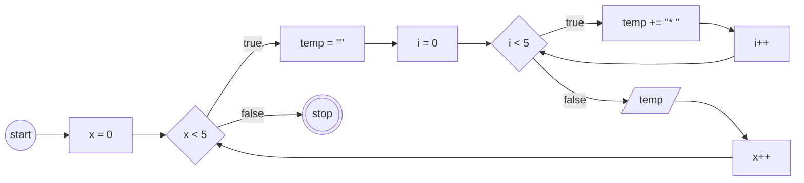
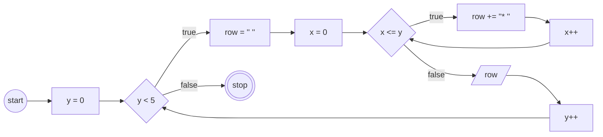
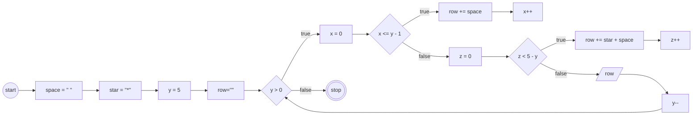
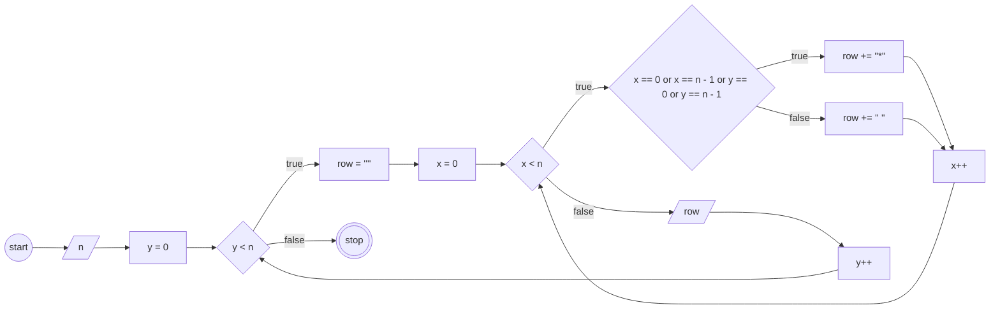

# Materi: Iteration

Membuat program javascript untuk mendalami materi for dan while loop.

---

## Soal 1

```js
// Output:
* * * * * 
* * * * * 
* * * * * 
* * * * * 
* * * * * 
```

[Link to Solution 1](index.js)

### Flowchart

---

## Soal 2

```js
// Output:
* 
* * 
* * * 
* * * * 
* * * * * 
```

[Link to Solution 2](index2.js)

### Flowchart



---

## Soal 3

```js
// Output
    * 
   * * 
  * * * 
 * * * * 
* * * * * 
```

[Link to Solution 3](index3.js)

### Flowchart



---

## Soal 4

```js
// Output:
* * * * * 
*       *
*       *
*       *
* * * * * 
```

[Link to Solution 4](index4.js)

### Flowchart

