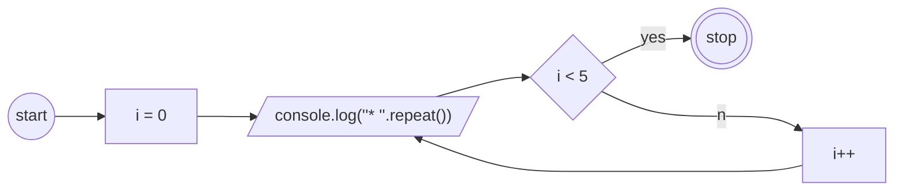

# Materi: Iteration

Membuat program javascript untuk mendalami materi for dan while loop.

## Latihan Soal

```js
// Soal 1

// * * * * * 
// * * * * * 
// * * * * * 
// * * * * * 
// * * * * * 
```



